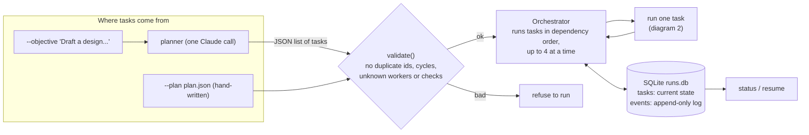
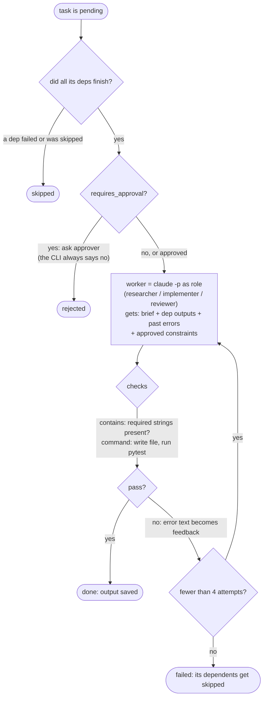
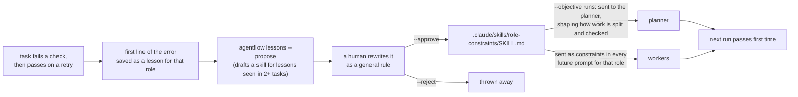
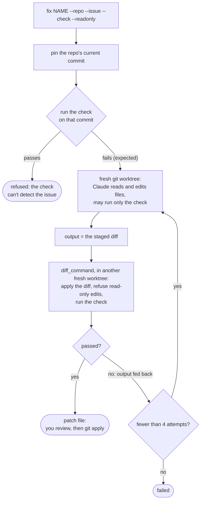
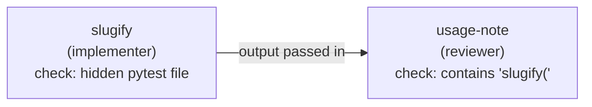

# agentflow diagrams

agentflow runs a list of tasks for Claude, where some tasks depend on others.
Each task is a `claude -p` call. Its output must pass an automatic check, and a
failed check sends the error back to Claude for another try. All state is kept
in SQLite, so a run can be resumed.

## 1. The whole thing

## 2. What happens to one task

## 3. The learning loop: lessons become skills

## 4. Fixing an issue in a codebase (`fix`)

Your checkout is never modified. Every attempt and every check uses its own
throwaway worktree, so a failed attempt leaves nothing behind.

## Example: `examples/slugify/plan.json`

1. The hidden test requires slugs of at most 50 characters, and the task brief
   never mentions this. The first attempt fails.
2. The pytest failure is fed back to Claude, and the next attempt passes.
3. `usage-note` then runs, using the slugify code as its input.
4. After the same failure happens in two runs, it can be turned into a
   constraint, so later runs pass on the first try.

The irreversible-command hook (`.claude/hooks/guard.py`) isn't part of the
engine. It's a separate safety net for interactive Claude Code sessions in this
folder. The text roles' Claude calls run with all tools turned off. The `fix`
coder runs with `--restricted`, which ignores project hooks, and its Bash is
limited to the check command.
